<p align="center">
  <picture>
    <source media="(prefers-color-scheme: light)" srcset="assets/banner.svg">
    
  </picture>
</p>

<h1 align="center">doodleduo</h1>

<p align="center">An infinite whiteboard you draw on together with friends at the same time, peer to peer in the browser.<br>
<a href="https://kwy404.github.io/doodleduo/">Website</a> &middot; <a href="https://kwy404.github.io/doodleduo/app/">Open the app</a> &middot; <a href="i18n/README.pt-BR.md">Leia em português</a></p>

Press **Invite friends**, read six words to a friend (or let them scan the QR code), and draw on the same endless slate while you talk: chat with replies and reactions, a voice call with strong noise suppression, camera bubbles that float next to each cursor, and screen sharing. Up to 5 people, no account, and no server of ours in the middle. Boards are saved in your browser.

<table>
  <tr>
    <td width="33%" valign="top"><picture><source media="(prefers-color-scheme: dark)" srcset="assets/icons/dark/pen.svg"></picture><br><b>Smooth, pressure aware pen</b><br>Plus a highlighter, an eraser, shapes, arrows and text.</td>
    <td width="33%" valign="top"><picture><source media="(prefers-color-scheme: dark)" srcset="assets/icons/dark/note.svg"></picture><br><b>Sticky notes and pictures</b><br>Paste or drop a picture: it is compressed and sent to everyone.</td>
    <td width="33%" valign="top"><picture><source media="(prefers-color-scheme: dark)" srcset="assets/icons/dark/cursor.svg"></picture><br><b>Live cursors</b><br>Each person has a color and a name on every screen.</td>
  </tr>
  <tr>
    <td valign="top"><picture><source media="(prefers-color-scheme: dark)" srcset="assets/icons/dark/select.svg"></picture><br><b>Select, move, resize, duplicate</b><br>Undo and redo per person.</td>
    <td valign="top"><picture><source media="(prefers-color-scheme: dark)" srcset="assets/icons/dark/merge.svg"></picture><br><b>Edits that merge</b><br>A CRDT keeps every copy of the board identical.</td>
    <td valign="top"><picture><source media="(prefers-color-scheme: dark)" srcset="assets/icons/dark/export.svg"></picture><br><b>Boards you keep</b><br>Saved in IndexedDB. Export PNG, SVG or a board file.</td>
  </tr>
  <tr>
    <td valign="top"><picture><source media="(prefers-color-scheme: dark)" srcset="assets/icons/dark/pinch.svg"></picture><br><b>Pan and pinch zoom</b><br>Two fingers on phones, big touch targets.</td>
    <td valign="top"><picture><source media="(prefers-color-scheme: dark)" srcset="assets/icons/dark/install.svg"></picture><br><b>Installable</b><br>A PWA that opens offline.</td>
    <td valign="top"><picture><source media="(prefers-color-scheme: dark)" srcset="assets/icons/dark/globe.svg"></picture><br><b>English and Portuguese</b><br>Picked from your browser, switchable in settings.</td>
  </tr>
  <tr>
    <td valign="top"><picture><source media="(prefers-color-scheme: dark)" srcset="assets/icons/dark/chat.svg"></picture><br><b>Chat</b><br>Replies and reactions, saved with the board.</td>
    <td valign="top"><picture><source media="(prefers-color-scheme: dark)" srcset="assets/icons/dark/mic.svg"></picture><br><b>Voice with noise suppression</b><br>Browser filters plus our own DSP worklet, with a mic test.</td>
    <td valign="top"><picture><source media="(prefers-color-scheme: dark)" srcset="assets/icons/dark/bubbles.svg"></picture><br><b>Camera bubbles and screens</b><br>Small cameras float by each cursor; share a screen.</td>
  </tr>
</table>

## How pairing works

<picture>
  <source media="(prefers-color-scheme: light)" srcset="assets/art/words.svg">
  
</picture>

1. The inviter gets six words (66 random bits from the BIP39 English list) and a QR code. They work once, for ten minutes.
2. Both devices derive a topic and an AES-GCM key from the words (PBKDF2, then HKDF) and meet on several public MQTT brokers at once. The brokers only see a random topic and ciphertext. The WebRTC offer and answer travel sealed with that key.
3. Once connected, the friend's screen shows six confirmation words made from the DTLS fingerprints of the connection. The inviter types them back. If someone sat in the middle, the words would not match, and three wrong tries close the connection.

Anyone already on a board can invite the next person. The mesh introduces newcomers to everyone, and forwards through a relay member when two people cannot reach each other directly.

## Why everyone sees the same board

<picture>
  <source media="(prefers-color-scheme: light)" srcset="assets/art/late-joiner.svg">
  
</picture>

Each element is a map of fields, and each field is a last writer wins register stamped with a Lamport time and the replica id. Deleting is a field too, so undo is just a newer write. Pen strokes are ordered point lists that only their author appends to, so chunks can arrive late or twice and still line up. A late joiner merges the full state in small parts and asks for the pictures it lacks; pictures are named by their SHA-256 and checked on arrival. The unit tests run thousands of random concurrent edits across three replicas over a lossy, reordering network and require identical results.

## Honest limits

- Drawing together needs at least one person who has the board to keep it open. There is no server that stores boards.
- Pairing depends on public MQTT brokers that are not ours. If none answers, pairing fails with a clear message.
- Some networks block direct connections. The app tests at start whether the public STUN servers answer. No TURN server is built in; you can add your own in the settings.
- Boards live in your browser's storage. Clearing site data deletes them, so export a board file to keep a copy.
- Pen pressure needs a pen that reports it. With a mouse or a finger, the width follows your speed.
- The eraser removes whole strokes and shapes. Pictures are scaled to 1600 pixels; animated GIFs keep their first frame.
- Reloading the page ends the live session. Invite each other again and the boards merge back.
- Calls are a full mesh: with five people each device sends its voice and camera four times, which needs a decent upload. Screen sharing needs a browser that supports it, so most phones cannot share.

## Meet Mabel and Otto

<picture>
  <source media="(prefers-color-scheme: light)" srcset="assets/mascot.svg">
  
</picture>

Mabel is the bold one, chalk up and already drawing. Otto is the calm one, crayon close, happy to watch first. See the [character sheet](assets/brand/character-sheet.svg).

## Development

```bash
npm install
npm test          # unit tests: CRDT convergence, smoothing, board file, pairing, mesh, QR
npm run lint      # ESLint
npm run rules     # house rules: no emoji, no long dashes, no product names
npm run e2e       # three browser profiles pair with six words, draw, chat and call at once
npm run serve     # http://127.0.0.1:8080/doodleduo/
```

The site is plain static files in `docs/` with relative paths, served the same way as GitHub Pages. Chat, calls, the mesh and the noise suppression are adapted from [howlden](https://kwy404.github.io/howlden/). Shared modules live in `src/` and are copied to `docs/app/core/` with `npm run core`. Styles use [Monsoon](https://kwy404.github.io/monsoon/) and the interface is declared with [Voodoo.js](https://kwy404.github.io/Voodoo.js/).

## License

[MIT](LICENSE), made by [Alexandre Kohler](https://github.com/kwy404).
