<p align="center">
  <picture>
    <source media="(prefers-color-scheme: light)" srcset="../assets/banner.svg">
    
  </picture>
</p>

<h1 align="center">doodleduo</h1>

<p align="center">Uma lousa infinita para desenhar junto com amigos ao mesmo tempo, de navegador para navegador.<br>
<a href="https://kwy404.github.io/doodleduo/">Site</a> &middot; <a href="https://kwy404.github.io/doodleduo/app/">Abrir o app</a> &middot; <a href="../README.md">Read in English</a></p>

Toque em **Convidar amigos** e mande seis palavras, um QR code ou um link (os três levam as mesmas palavras), e desenhem na mesma lousa sem fim. Até 5 pessoas, sem conta e sem servidor nosso no meio. Os quadros ficam salvos no seu navegador.

## O que tem

- Caneta suave que respeita a pressão, marca-texto, borracha, formas, setas e texto.
- Notas adesivas e imagens coladas ou arrastadas, comprimidas e enviadas a todos.
- Cursores ao vivo com cor e nome de cada pessoa.
- Conversa com respostas e reações, chamada de voz com supressão de ruído forte e teste de microfone, bolhas de câmera ao lado de cada cursor e compartilhamento de tela.
- Desligar o microfone ou a câmera e escolher microfone, câmera e alto falante nas configurações, mesmo durante a chamada.
- Selecionar, mover, redimensionar e duplicar. Desfazer e refazer por pessoa.
- Edições que se juntam: um CRDT mantém todas as cópias do quadro iguais.
- Quadros salvos no IndexedDB. Exporte PNG, SVG ou um arquivo do quadro.
- Mover com dois dedos e pinçar para zoom no celular. Instalável (PWA). Português e inglês.

<picture>
  <source media="(prefers-color-scheme: light)" srcset="../assets/art/talk.svg">
  
</picture>

## Como o pareamento funciona

<picture>
  <source media="(prefers-color-scheme: light)" srcset="../assets/art/words.svg">
  
</picture>

1. Quem convida recebe seis palavras (66 bits aleatórios da lista BIP39 em inglês), um QR code e um link de convite com botão Copiar. Os três levam as mesmas palavras e valem uma vez, por dez minutos. O link é `.../app/#join=palavra-palavra-...`: as palavras ficam no hash, que o navegador nunca envia a servidor nenhum. Abrir o link já começa a entrada, e o app tira as palavras da barra de endereço. Colar a frase inteira (ou o link) em qualquer caixa espalha uma palavra por caixa.
2. Os dois aparelhos derivam um tópico e uma chave AES-GCM das palavras e se encontram em vários brokers MQTT públicos ao mesmo tempo. Os brokers só veem um tópico aleatório e dados cifrados.
3. Já conectado, a tela do amigo mostra seis palavras de confirmação feitas das impressões DTLS da conexão. Quem convidou digita essas palavras. Se alguém estivesse no meio, elas não confeririam.

## Limites, com honestidade

- Desenhar junto precisa que pelo menos uma pessoa com o quadro o mantenha aberto. Não há servidor guardando quadros.
- O pareamento depende de brokers MQTT públicos que não são nossos.
- Algumas redes bloqueiam conexões diretas. O app testa ao abrir se os servidores STUN públicos respondem. Não há servidor TURN embutido; você pode adicionar o seu nas configurações.
- Os quadros ficam no armazenamento do navegador. Limpar os dados do site apaga os quadros, então exporte um arquivo para ter uma cópia.
- A pressão precisa de uma caneta que a informe. Com mouse ou dedo, a espessura segue a velocidade.
- A borracha apaga traços e formas inteiros. Imagens são reduzidas a 1600 pixels; GIFs animados ficam com o primeiro quadro.

## Desenvolvimento

```bash
npm install
npm test      # testes unitários
npm run e2e   # dois perfis de navegador entram por link, palavras e QR code, desenham, conversam e falam
npm run serve # http://127.0.0.1:8080/doodleduo/
```

## Licença

[MIT](../LICENSE), feito por [Alexandre Kohler](https://github.com/kwy404).
